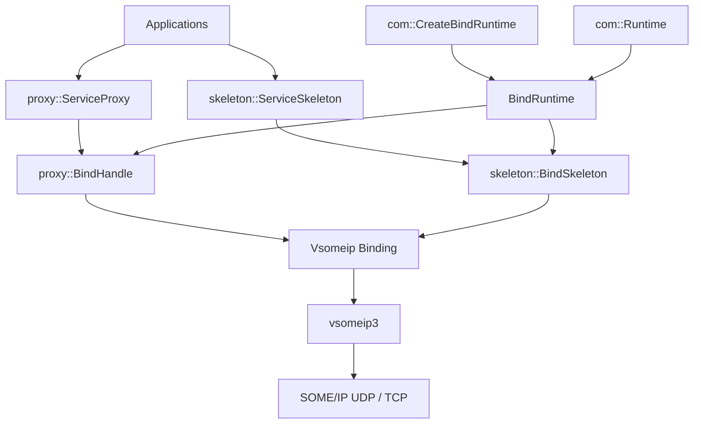

# com - 通信抽象层（贴近 AUTOSAR ara::com）

## 概述

`com` 模块提供车载通信的抽象接口层，将上层应用与底层通信协议解耦。

当前实现：

```text
应用层
  -> ServiceProxy / ServiceSkeleton
  -> BindHandle / BindSkeleton
  -> BindRuntime
  -> com::Runtime
  -> VsomeipBindRuntime / VsomeipBindHandle / VsomeipBindSkeleton
  -> vsomeip3
  -> SOME/IP UDP / TCP
```

底层目前只实现 vsomeip 绑定。DDS、Raw TCP 仅作为后续扩展点。

## 当前架构



关键变化：应用不再直接创建 `VsomeipBindRuntime`，而是通过工厂创建。

## 当前状态

| 能力 | 状态 |
| --- | --- |
| `com::Runtime` 单例 | 完成 |
| `BindRuntime` 抽象 | 完成 |
| `BindHandle` 抽象 | 完成 |
| `BindSkeleton` 抽象 | 完成 |
| `ServiceProxy` | 完成 |
| `ServiceSkeleton` | 完成 |
| vsomeip 绑定 | 完成 |
| 绑定工厂 | 完成 |
| 同步请求 | 完成 |
| Future/Promise 异步请求 | 完成 |
| 事件订阅 | 完成 |
| 服务发现 | 完成 |
| DDS 绑定 | 预留 |
| Raw TCP 绑定 | 预留 |

## 核心类型

| 类型 | 来源 | 说明 |
| --- | --- | --- |
| `com::Result<T>` | ara::core | 别名到 `ara::core::Result<T, ErrorCode>` |
| `com::ComErrc` | com | 通信层错误码 |
| `com::ComErrorDomain` | com | 通信层错误域 |
| `com::Future<T>` | ara::core | 异步结果 |
| `com::Promise<T>` | ara::core | 异步承诺 |
| `com::InstanceSpecifier` | ara::core | AUTOSAR 风格服务标识 |

## 核心接口

### Runtime

```cpp
class Runtime {
public:
    static Runtime *Get() noexcept;
    Result<void> Init() noexcept;
    Result<void> Deinit() noexcept;
    void Start() noexcept;
    void Stop() noexcept;

    Result<void> RegisterBindRuntime(std::unique_ptr<BindRuntime> rt) noexcept;
    Result<void> UnregisterBindRuntime(std::string const &name) noexcept;
    BindRuntime *GetBindRuntime(std::string const &name) noexcept;
    std::vector<std::string> GetBindRuntimeNames() const noexcept;

    void RegisterServiceMapping(...) noexcept;
    bool ResolveServiceMapping(...) const noexcept;
};
```

### 绑定工厂

```cpp
// com/bind_runtime_factory.h
std::unique_ptr<BindRuntime> CreateBindRuntime(
    const std::string& binding,
    const std::string& applicationName);
```

当前支持：

```cpp
com::CreateBindRuntime("vsomeip", "my-app");
```

后续可以扩展：

```cpp
com::CreateBindRuntime("dds", "my-app");
com::CreateBindRuntime("raw_tcp", "my-app");
```

### BindRuntime

```cpp
class BindRuntime {
public:
    virtual Result<void> Init() noexcept;
    virtual Result<void> Deinit() noexcept;
    virtual void Start() noexcept;
    virtual void Stop() noexcept;

    virtual void CreateBindSkeleton(...) = 0;
    virtual void GetAvailableServiceHandles(...) = 0;
    virtual void RegisterFindServiceHandle(...) = 0;
    virtual void UnregisterFindServiceHandle(...) = 0;
    virtual char const *GetName() const noexcept = 0;
};
```

### Proxy 层

```cpp
proxy::BindHandle
proxy::BindProxy
proxy::ServiceProxy
```

- `SendRequest()`：同步请求。
- `SendRequestAsync()`：异步请求，返回 Future。
- `IsAvailable()` / `WaitForAvailable()`：服务可用性检查。

### Skeleton 层

```cpp
skeleton::BindSkeleton
skeleton::Skeleton
skeleton::ServiceSkeleton
```

- `RegisterMethodHandler()`：注册方法处理函数。
- `Offer()` / `StopOffer()`：服务发布与停止。
- `SendEvent()`：发送事件通知。

## vsomeip 绑定实现

文件：

```text
src/com/src/vsomeip/vsomeip_bind_runtime.cpp
src/com/src/vsomeip/vsomeip_bind_handle.cpp
src/com/src/vsomeip/vsomeip_bind_skeleton.cpp
```

职责：

```text
VsomeipBindRuntime
  - runtime::get()
  - create_application()
  - application->init()
  - application->start()

VsomeipBindSkeleton
  - request_service()
  - offer_service()
  - register_message_handler()
  - create_response()
  - send()

VsomeipBindHandle
  - request_service()
  - create_request()
  - set service / instance / method / payload
  - send()
  - register_message_handler()
  - request_event()
```

## 使用示例

### 服务端

```cpp
#include "com/runtime.h"
#include "com/bind_runtime_factory.h"
#include "com/skeleton.h"

int main() {
    auto *runtime = com::Runtime::Get();
    runtime->Init();

    auto createdRuntime = com::CreateBindRuntime("vsomeip", "echo_service");
    if (!createdRuntime) {
        return 1;
    }

    if (!runtime->RegisterBindRuntime(std::move(createdRuntime))) {
        return 1;
    }

    auto *bindRuntime = runtime->GetBindRuntime("vsomeip");

    com::skeleton::ServiceSkeleton skeleton(0x1234, 1);
    std::vector<std::unique_ptr<com::skeleton::BindSkeleton>> bindSkeletons;
    bindRuntime->CreateBindSkeleton(skeleton, 1, bindSkeletons);

    for (auto &bs : bindSkeletons) {
        bs->RegisterMethodHandler(0x0001,
            [](const std::vector<uint8_t>& request,
               std::vector<uint8_t>& response) {
                response = request;
            });
        bs->Offer();
    }

    runtime->Start();

    for (auto &bs : bindSkeletons) {
        bs->StopOffer();
    }

    runtime->Stop();
    runtime->Deinit();
    return 0;
}
```

### 客户端

```cpp
#include "com/runtime.h"
#include "com/bind_runtime_factory.h"
#include "com/proxy.h"

int main() {
    auto *runtime = com::Runtime::Get();
    runtime->Init();

    auto createdRuntime = com::CreateBindRuntime("vsomeip", "echo_client");
    if (!createdRuntime) {
        return 1;
    }

    if (!runtime->RegisterBindRuntime(std::move(createdRuntime))) {
        return 1;
    }

    auto *bindRuntime = runtime->GetBindRuntime("vsomeip");

    com::FindServiceHandle findHandle{0x1234, 1};
    bindRuntime->RegisterFindServiceHandle(findHandle,
        [](com::ServiceHandleContainer<
            std::shared_ptr<com::proxy::BindHandle>> const& handles) {
            for (auto const& handle : handles) {
                if (!handle || !handle->IsValid()) {
                    continue;
                }

                std::vector<uint8_t> request = {1, 2, 3};
                auto result = handle->SendRequest(
                    0x0001, request, std::chrono::seconds(5));

                if (result) {
                    // result.Value()
                }
            }
        });

    runtime->Start();
    runtime->Deinit();
    return 0;
}
```

## CMake 选项

```cmake
option(COM_WITH_VSOMEIP "Build with vsomeip support" ON)
option(COM_BUILD_EXAMPLES "Build com examples" OFF)
```

## 已知限制

1. `ara::core::Future::then()` 的续体调用方式与标准 AUTOSAR 不完全一致，建议使用 `GetResult()` / `get()`。
2. 当前 vsomeip 同步请求采用 method 级 `register_message_handler`，同一个 `(service, instance, method)` 并发请求可能互相覆盖 handler；一发一收场景没问题，高并发同 method 请求需要进一步改造。
3. DDS 和 Raw TCP 目前仅预留，尚未实现。

## 与 CAPI 的关系

- 复用 CAPI/ara::core 的 `Result`、`Future`、`Promise`、`ErrorCode`、`InstanceSpecifier`。
- 参考 CAPI 通信架构，但做了简化。
- 跳过 nsomeip 中间层，直接绑定 vsomeip3。
- 本模块主要用于理解 CAPI 的抽象思想和 vsomeip 集成方式。

## License

Apache License 2.0
